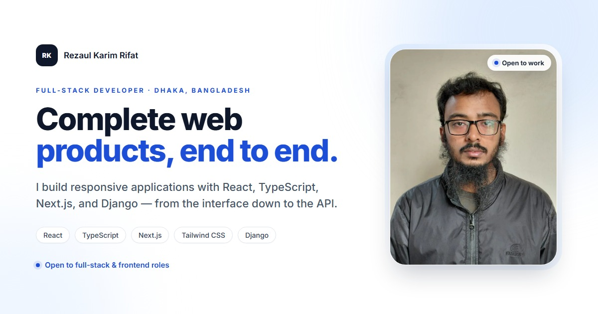

# Rezaul Karim Rifat — Developer Portfolio

A recruiter-friendly portfolio for **Rezaul Karim Rifat**, a full-stack web developer based in Dhaka, Bangladesh. The site focuses on a small number of real projects, the problems they solve, and the decisions behind them.



## Live site

https://developer-portfolio-sooty-phi.vercel.app/

## What's inside

- A hero with role, one-line value statement, resume, GitHub, LinkedIn, and email.
- Five selected projects with the problem, role, technology, outcome, process notes, live demo, and source code.
- A short About section and logically grouped skills.
- A concise experience/learning section.
- A direct contact section with email, GitHub, LinkedIn, location, and resume.

## Tech stack

- React 19
- TypeScript
- Vite 8
- Tailwind CSS 4
- daisyUI 5
- oxlint

## Run locally

```bash
npm install
npm run dev
```

## Build and verify

```bash
npm run lint
npm run build
npm run preview
```

There is no test suite. `npm run lint` and `npm run build` are the verification steps.

## Project data

`public/data.json` is the source of truth for project content. Only entries with `"featured": true` are rendered — currently five projects. The matching TypeScript shape lives in `src/types/projectDataTypes.ts`.

- Project screenshots are optimized JPEGs in `public/projects/`.
- The hero image is `src/assets/me-0.jpg`.
- Lower-rated or older entries remain in `data.json` as an archive but are not shown.

Project process notes describe implementation details taken from the actual repositories. If you change a project, update its `process` entries to match what the code does; do not add metrics or outcomes you cannot verify.

## Project structure

```text
src/
├── assets/               # hero image
├── components/
│   ├── About.tsx         # about + grouped skills
│   ├── Banner.tsx        # hero
│   ├── Contact.tsx       # contact details and email CTA
│   ├── Experience.tsx    # learning journey
│   ├── Footer.tsx
│   ├── Nav.tsx
│   └── projects/
│       ├── FeaturedProjectsCard.tsx
│       └── Projects.tsx
├── types/
│   └── projectDataTypes.ts
├── App.tsx
├── index.css
└── main.tsx
public/
├── data.json
├── projects/             # optimized project screenshots
├── og-image.jpg
└── resume.pdf
```

## Deployment

The site is linked to Vercel and deploys from the `main` branch. Run `npm run build` before pushing; the output goes to `dist/`.

If the production URL changes, update the canonical URL, Open Graph URLs, and `public/sitemap.xml`.

## Contact

- Email: [rezaul2002104@gmail.com](mailto:rezaul2002104@gmail.com)
- GitHub: https://github.com/rezasdsju
- LinkedIn: https://www.linkedin.com/in/rezaul-karim-rifat-833154370/
